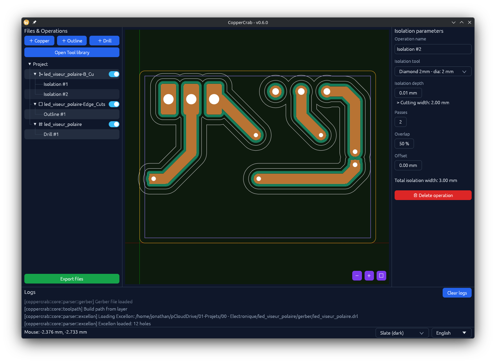
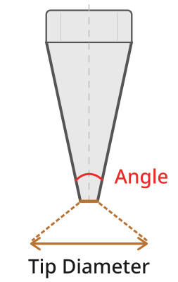

# 🦀 CopperCrab


> **PCB CAM software for CNC isolation routing, written in Rust.**

CopperCrab is a desktop application that turns Gerber and Excellon files into G-code for milling PCBs on a CNC router. Import your copper, outline and drill files, attach machining operations to each of them (isolation, outline cutting, drilling), preview the toolpaths live, and export one G-code file per operation.



---

## Features

### Project & files

- Project tree: import any number of copper, outline and drill files, each with its own list of operations
- Gerber import for copper layers (`.gbr`, `.ger`, `.gtl`, `.gbl`) and board outlines (`.gbr`, `.ger`, `.gto`, `.gko`)
- Excellon drill import (`.drl`, `.txt`)
- Per-file visibility toggle, rename and delete
- Board placement: move the board's bottom-left corner to (0, 0), mirror the whole project or a single file on X / Y

### Operations

- **Isolation** (copper files) — V-Bit or End Mill, depth, number of passes, pass overlap (%), start offset. The effective cutting width at depth and the total isolation width are displayed live.
- **Outline** (outline files) — End Mill, cut depth, single contour offset by the tool radius
- **Drill** (drill files) — Drill Bit, drill depth, peck step
- Multi-depth passes: cuts deeper than the tool's `max_depth` are split into several Z steps
- Toolpaths are regenerated automatically whenever a parameter changes; the selected operation is highlighted on the canvas

### G-code

- GRBL-flavoured G-code (metric, absolute coordinates)
- Project-wide Safe Z and Final Z
- One file per operation, named after the operation

### Interface

- Real-time 2D preview with zoom (scroll wheel or buttons), pan and "fit to board"
- Persistent tool library (V-Bits, End Mills, Drill Bits) stored as TOML
- Four themes (Slate, Charcoal, Frost, Paper) and two languages (English, French), switchable from the status bar
- Persistent settings: window size, language, theme
- Integrated log panel

---

## Usage

### Basic workflow

1. **Import files** — use the **+ Copper**, **+ Outline** and **+ Drill** buttons at the top of the left panel. Each imported file appears in the project tree.
2. **Add operations** — right-click a file in the tree (or select it and use the button in the right panel) to add an isolation, outline or drill operation.
3. **Configure operations** — select an operation in the tree, pick a tool and set its parameters in the right panel. The toolpath updates on the canvas immediately.
4. **Set project parameters** — select the **Project** root node to set Safe Z / Final Z, move the board to the origin or mirror it.
5. **Export** — click **Export files** and choose a folder. A G-code file is written for every operation of every file.

### Tool library

Click **Open Tool library** in the left panel to add, edit or delete V-Bits, End Mills and Drill Bits. Each tool stores its geometry, maximum depth per pass, feed rate, plunge rate and spindle speed.

For a V-Bit, the cutting width at a given depth is computed as:

```
width = tip_diameter + 2 × depth × tan(angle / 2)
```



### Canvas navigation

- **Pan** — click and drag
- **Zoom** — scroll wheel (zooms toward the cursor) or the `−` / `+` buttons
- **Fit to board** — `⊡` button

### Configuration files

The tool library (`tools.toml`) and application settings (`app_config.toml`) are stored in your platform's config directory. Its exact path is printed in the log panel at startup.

---

## Known Limitations

CopperCrab is functional but still in early development.

### Gerber

- **Apertures** — `Circle` and `Rectangle` apertures are supported; `Obround` and `Polygon` apertures are ignored (with a warning).
- **Aperture macros** — `Circle`, `Vector Line`, `Center Line` and `Outline` primitives are supported, with arithmetic expressions and variables. `Polygon`, `Moiré` and `Thermal` primitives are not.
- **Region mode** — regions are built from straight segments only; arcs inside regions are not handled.
- **Polarity** (`%LP*%`) — clear polarity is ignored, so cut-outs in copper pours will be machined incorrectly.
- **Step and repeat** (`%SR*%`), aperture blocks, and image transformations (mirroring, rotation, scaling, offset) are not supported.
- **Inch units** (`%MOIN*%`) — parsed, but the conversion to mm has not been validated.
- **Arcs** are approximated by polylines.

### Excellon

Supported: metric files with decimal coordinates (`X142.0Y-67.92`), tool definitions (`T1C0.800`) and tool selection — the typical KiCad export.

Not supported: inch units, integer / implicit-decimal coordinates, routed slots (`G85`, `G00`/`G01`), repeat commands (`R`), drill cycles in the body, `OFFSET`.

### Machining

- **One tool per drill operation** — every hole of a drill file is drilled with the operation's bit, regardless of its diameter. Holes are not yet sorted or filtered by size.
- **No outline tabs** — the board is cut free on the last pass.
- **Single side** — only one copper side per operation; for double-sided boards, mirror the bottom layer and run it as a separate job.
- **GRBL only** — no LinuxCNC / Mach3 dialect yet.
- **No tool change / spindle dwell** — each operation is a separate file; the spindle starts (`M3`) without a `G4` dwell.

### Platform

- **Wayland icon** — the application icon may not display on KDE Wayland without a `.desktop` file.
- **macOS** — the binary is unsigned; right-click → Open on first launch to bypass Gatekeeper.

---

## Roadmap

- [ ] Inch support (Gerber and Excellon)
- [ ] Map drill bits to hole sizes
- [ ] Outline tabs (count, length, thickness)
- [ ] Remaining apertures and macro primitives (Obround, Polygon, Moiré, Thermal)
- [ ] Arcs in region mode
- [ ] Clear polarity
- [ ] LinuxCNC and Mach3 G-code dialects
- [ ] Export / import of the tool library
- [ ] Save / load projects
- [ ] Unit tests for parsers and toolpath generation

---

## Building from Source

### Prerequisites

- [Rust](https://rustup.rs/) (edition 2024, stable toolchain)
- A C/C++ compiler (required by `clipper2`) — `gcc` or `clang`
- On Linux: GTK 3 and xdo development files for native file dialogs

```bash
# Arch Linux
sudo pacman -S gcc gtk3 xdotool

# Ubuntu/Debian
sudo apt install build-essential libgtk-3-dev libxdo-dev
```

### Build and run

```bash
git clone https://github.com/jnthbdn/CopperCrab.git
cd CopperCrab
cargo run --release
```

The release build is noticeably faster on large boards.

### Log level

The log level is controlled by `RUST_LOG` (set to `debug` by default in `.cargo/config.toml`):

```bash
RUST_LOG=info cargo run
RUST_LOG=coppercrab=debug cargo run   # only CopperCrab logs
```

### Releases

Pushing a `v*` tag triggers the GitHub Actions workflow, which builds a Windows `.exe`, a Linux AppImage and a macOS `.dmg`, and publishes them in a GitHub release with a generated changelog.

---

## Contributing

Contributions are welcome — bug reports, feature requests and pull requests alike.

1. Fork the repository
2. Create a branch: `git checkout -b feat/my-feature`
3. Make your changes (see the architecture notes below)
4. Open a pull request explaining what changed and why

Commit messages follow [Conventional Commits](https://www.conventionalcommits.org/) (`feat:`, `fix:`, `refactor:`…), which are used to generate the release changelog.

### Architecture

```
src/
├── main.rs            # Entry point: logger, locale, config, window
├── core/              # Business logic — no UI dependencies
│   ├── geometry.rs    # Primitive types (Point2d, Segment, Arc, Circle, Rectangle)
│   ├── bounding_box.rs
│   ├── parser/        # Gerber and Excellon → PcbLayer / DrillLayer
│   ├── toolpath/      # Clipper2-based toolpath generation + G-code output
│   └── tools/         # CncTool trait, VBit / EndMill / DrillBit, ToolLibrary
└── ui/                # egui frontend — depends on core only
    ├── mod.rs         # App state, project tree, parameter panels, canvas
    ├── app_config.rs  # Persistent settings
    └── widget/        # Canvas drawing, tool library window, status bar…
```

`core` exposes no egui types: implement new logic there first, then wire it up in `ui`.

### Translations

CopperCrab uses [`rust-i18n`](https://github.com/longbridgeapp/rust-i18n). Strings live in three YAML files under `locales/`, split by purpose:

| File            | Content                                  |
| --------------- | ---------------------------------------- |
| `app.yml`       | Log messages, buttons, errors, status bar |
| `label.yml`     | UI labels                                |
| `tooltips.yml`  | Tooltips                                 |

Every key holds all its translations side by side:

```yaml
ui.button.tool_library:
  en: "Open Tool library"
  fr: "Ouvrir la bibliothèque d'outils"
```

To add a language:

1. Add an entry with its [BCP 47](https://en.wikipedia.org/wiki/IETF_language_tag) tag (e.g. `de:`) to **every** key of the three files. Keep `%{...}` placeholders unchanged.
2. Register it in `AVAILABLE_LOCALE` in `src/ui/mod.rs`:
   ```rust
   const AVAILABLE_LOCALE: [(&str, &str); 3] =
       [("en", "English"), ("fr", "Français"), ("de", "Deutsch")];
   ```
3. Run `cargo run`, switch language from the status bar and check every panel.

Missing translations are reported in the log (`log-miss-tr` feature) and fall back to English.

### Code style

- `cargo fmt`
- Log through the `log` facade (`log::info!`, `log::warn!`…), never `println!`
- English for code, comments and log keys

---

## Dependencies

| Crate                                                                                            | Purpose                                        |
| ------------------------------------------------------------------------------------------------ | ---------------------------------------------- |
| [`eframe`](https://crates.io/crates/eframe) / [`egui`](https://crates.io/crates/egui)            | Native desktop GUI                             |
| [`egui-elegance`](https://crates.io/crates/egui-elegance)                                        | Widgets and themes                             |
| [`egui-phosphor`](https://crates.io/crates/egui-phosphor)                                        | Phosphor icon font                             |
| [`egui_ltreeview`](https://crates.io/crates/egui_ltreeview)                                      | Project tree view                              |
| [`egui_extras`](https://crates.io/crates/egui_extras) + [`image`](https://crates.io/crates/image) | Image loading                                  |
| [`clipper2`](https://crates.io/crates/clipper2)                                                  | Polygon union and offsetting (toolpaths)       |
| [`lyon`](https://crates.io/crates/lyon)                                                          | Tessellation for rendering concave shapes      |
| [`gerber_parser`](https://crates.io/crates/gerber_parser)                                        | Gerber RS-274X parsing                         |
| [`evalexpr`](https://crates.io/crates/evalexpr)                                                  | Expression evaluation in aperture macros       |
| [`rfd`](https://crates.io/crates/rfd)                                                            | Native file dialogs                            |
| [`sanitize-filename`](https://crates.io/crates/sanitize-filename)                                | Safe G-code file names from operation names    |
| [`serde`](https://crates.io/crates/serde) + [`toml`](https://crates.io/crates/toml)              | Tool library and settings serialization        |
| [`directories`](https://crates.io/crates/directories)                                            | Platform config directory                      |
| [`rust-i18n`](https://crates.io/crates/rust-i18n) + [`sys-locale`](https://crates.io/crates/sys-locale) | Translations and system language detection |
| [`log`](https://crates.io/crates/log) + [`env_logger`](https://crates.io/crates/env_logger)      | Logging                                        |

---

## License

MIT — see [LICENSE](LICENSE) for details.
